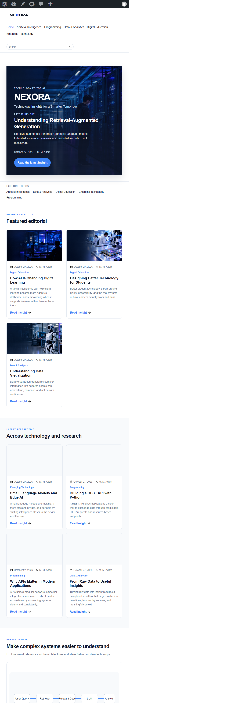
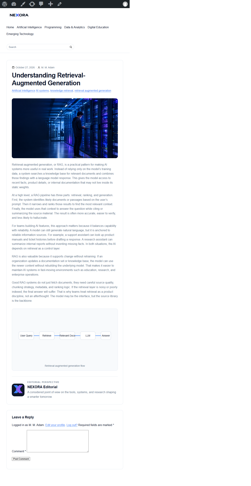

# NEXORA WordPress Theme

NEXORA is a reusable classic WordPress theme for a technology and digital-learning editorial publication. It presents technology insights, research perspectives, programming articles, and digital-education content through a responsive editorial interface.

## Student information

- **Name:** Muhammad Mansur Adam
- **NIM:** 2406431100110
- **GitHub:** [WebDesigner019/nexora-wordpress-theme](https://github.com/WebDesigner019/nexora-wordpress-theme)

## Features

- Classic WordPress theme using Template Hierarchy and The Loop
- Dynamic homepage with hero, featured editorial, and technology/research sections
- Dynamic posts, categories, tags, excerpts, authors, dates, permalinks, and featured images
- Responsive header and navigation with a mobile three-line menu toggle
- Native WordPress search form and search results
- Blog index, archive, category, search, single-post, page, and 404 templates
- Reusable template parts for cards, article diagrams, editorial identity, and single posts
- Sidebar and comments support
- WordPress pagination
- Approved NEXORA brand, article, diagram, icon, and author assets
- Accessible skip link, semantic landmarks, focus states, labels, image alt text, and ARIA states
- No custom post type or static HTML dependency

## Technology

- PHP
- HTML5
- CSS3
- Vanilla JavaScript
- WordPress Template Hierarchy
- WordPress Loop and `WP_Query`
- WordPress-native theme setup, menus, thumbnails, pagination, search, comments, and escaping

## Theme structure

```text
nexora/
├── assets/
│   ├── brand/
│   ├── diagrams/
│   ├── icons/
│   ├── images/
│   ├── js/
│   └── social/
├── template-parts/
├── archive.php
├── comments.php
├── footer.php
├── front-page.php
├── functions.php
├── header.php
├── home.php
├── index.php
├── page.php
├── search.php
├── sidebar.php
├── single.php
├── style.css
└── README.md
```

## Installation

1. Download or clone this repository.
2. Copy the `nexora` folder into `wp-content/themes/`.
3. Open the WordPress dashboard.
4. Go to **Appearance → Themes**.
5. Activate **Nexora**.
6. Go to **Appearance → Menus**, create or assign a menu to the **Primary Menu** location.
7. Add WordPress posts with featured images and assign them to categories.
8. Set the site title and tagline under **Settings → General**.

The theme works through `front-page.php` and does not require a static HTML homepage. WordPress posts remain editable through the normal Posts interface.

## Homepage content model

The homepage uses published standard WordPress posts:

- One sticky post is used as the selected hero article.
- Up to three additional published posts appear in Featured Editorial.
- Up to four further published posts appear in Across Technology and Research.
- Posts are excluded from later sections once used earlier.
- Featured images, excerpts, metadata, categories, and permalinks are dynamic.

## Screenshots

### Homepage



### Article detail



## Verification

The implementation was verified locally on WordPress with:

- PHP lint across every PHP template
- Desktop, tablet, and mobile responsive checks
- Mobile navigation open/close checks
- Native search query checks
- Homepage no-duplicate section checks
- Featured-image and local-asset availability checks
- RAG and API article diagram checks
- Article and comment-layout overflow checks

## Lecturer requirement checklist

| Requirement | Implementation |
|---|---|
| Header and navigation | `header.php`, registered Primary Menu, mobile menu toggle |
| Footer | `footer.php` |
| Front page | `front-page.php` with dynamic editorial queries |
| Blog/archive | `home.php`, `archive.php`, reusable Loop template parts |
| Single article | `single.php`, comments, metadata, diagrams, editorial block |
| Sidebar/supporting component | `sidebar.php` and registered Primary Sidebar |
| Template Hierarchy and The Loop | Classic WordPress templates and native `WP_Query` |
| Theme stylesheet | `style.css` with theme header and responsive design |
| Theme functions | `functions.php` with setup, menus, thumbnails, assets, pagination |
| Responsive design | Desktop, tablet, and mobile breakpoints |
| Original identity | NEXORA logo, assets, editorial content model, and visual system |

## Submission scope

This repository contains only the NEXORA theme source code and approved theme assets. It does not contain the WordPress core installation, database exports, uploads outside the theme, credentials, passwords, or configuration files.
